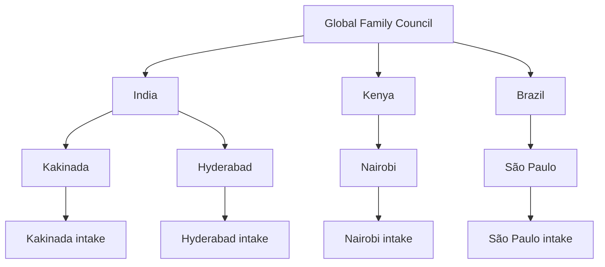

# Open Family

An open-source family of agents that carries women's ideas from every city to the world.

A woman sends her idea by phone call, voice note or WhatsApp. No money is asked for and none is paid. The family keeps her private, gives her fair contribution points for the idea itself, and introduces her to women with similar ideas in other countries, so they can build it together and gain real, hands-on experience.

```bash
npm test          # 18 tests, no install or keys needed
npm run demo      # four cities in three countries, end to end
```

Needs Node 20 or later. There are no required dependencies.

## The family



| Level | Instructions | Job |
|---|---|---|
| Global council | [`agents/global/AGENTS.md`](agents/global/AGENTS.md) | Checks the market, allocates points, keeps the ledger, links similar ideas worldwide |
| Country | [`agents/country/AGENTS.md`](agents/country/AGENTS.md) | Parent of its cities; relays ideas, points and news |
| City | [`agents/city/AGENTS.md`](agents/city/AGENTS.md) | Understands ideas, finds mentors, helps sibling cities |
| Intake | [`agents/intake/AGENTS.md`](agents/intake/AGENTS.md) | Talks to contributors; keeps their contact details in a local vault |

Each level's frontmatter lists its **skills** (in [`skills/`](skills/)) and the **tools** (in [`tools/`](tools/)) it may use. The runtime enforces the tool list. Every country and city also gets its own node file under [`agents/nodes/`](agents/nodes/).

## How agents talk

Messages follow the tree: up to the closest shared parent, then down. Kakinada talks to Nairobi through India, the council and Kenya, so every parent on the way stays informed. All message types are in [`skills/family-messaging/SKILL.md`](skills/family-messaging/SKILL.md).

What `npm run demo` prints for one idea:

```
idea.submitted    IN-kakinada/intake → IN-kakinada
idea.review       IN-kakinada → IN
idea.review       IN → global
share.granted     global → IN
share.granted     IN → IN-kakinada
share.granted     IN-kakinada → IN-kakinada/intake
collab.introduce  global → IN → IN-kakinada → IN-kakinada/intake
help.request      IN-kakinada → IN → IN-hyderabad
```

## The family's promises, and the tests that hold them

| Promise | Enforced by | Test |
|---|---|---|
| Her phone number, email, ID number and location never leave her city's intake | `tools/redact.mjs` and a guardian check on every upward hop in `runtime/bus.mjs` | `privacy`, `guardian` |
| Points depend only on the idea. No early bonus, no late penalty | `tools/shares.mjs` takes no time input and rejects extra arguments; points are compared with the outside market only | `fair shares` (order swap) |
| An idea that already exists earns points for its enhancement | `enhancement` mode in `tools/shares.mjs` | `fair shares` |
| Nobody can quietly change past points | Hash-chained ledger in `tools/ledger.mjs` | `ledger` |
| Similar ideas in different places are brought together | `collab.introduce` from the council | `joint family` |
| Each level only uses its own tools | Frontmatter `tools:` list | `tool permissions` |

## Add a country or city

```bash
node scripts/spawn-node.mjs --country KE --country-name Kenya --city KE-mombasa --city-name Mombasa --languages sw,en --channels call,whatsapp
```

This updates `family.json` and writes `agents/nodes/KE/KE-mombasa/AGENTS.md`. The sibling cities' files list the new city too.

## Use Claude as the city brain

By default, cities use an offline rule brain, so everything runs with no keys. To have Claude review ideas and suggest enhancements:

```bash
npm install @anthropic-ai/sdk
```

```bash
FAMILY_BRAIN=claude ANTHROPIC_API_KEY=... npm run demo
```

The brain sends only redacted text and asks for JSON, which it validates and clamps. On any error or refusal it falls back to the rule brain. See `runtime/brain.mjs`.

## Monitoring

| Command | What it does |
|---|---|
| `npm run monitor` | Cyber risk monitor: HTTPS, certificates, security headers, MCP servers, and a scan of this repository for leaked keys, phone numbers, Aadhaar numbers, emails, GPS locations and raw recordings |
| `npm run monitor:selftest` | Plants fake leaks and checks the monitor catches all of them |
| `npm run mcp:test -- cc-ai-cam https://mcp.trustadda.com/mcp` | Tests a remote MCP server in 8 steps |

Settings and the women-centric risk register are in `monitoring/cyber-risk-monitor/config.json`.

## What is not built yet

- **Real channels.** `IntakeAgent.accept()` takes a transcript. Speech-to-text, the phone line and the WhatsApp Business integration still need to be connected in front of it.
- **Running across machines.** All nodes run in one process today. The bus interface (`send`, `path`, `register`) is the seam where an HTTP or MCP transport goes, so each country or city can run on its own server.
- **Names and street addresses** are not detected by the privacy shield yet.
- **Market check** uses a small seed catalog and word overlap. Grow the catalog, or add web research through the Claude brain.

## Contributing

Every agent, skill and tool is plain JavaScript or markdown. Improve an `AGENTS.md`, add a skill, add your city, and send a pull request. Run `npm test` and `npm run monitor` first.

## License

MIT
